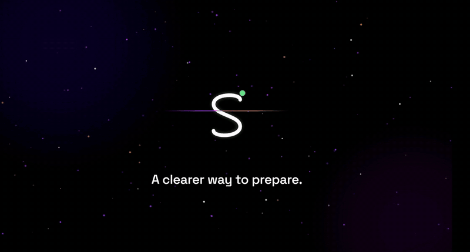

<div align="center">


# PrepTrack

### Sunil Bhaiya PrepTrack — the rebuilt, offline-first evolution of the original Sunil Bhaiya tracker.

*Know exactly what to study next.*

[](https://swastiksingh-dev.github.io/Sunil-Bhaiya-PrepTrack/)
[](https://nextjs.org/)
[](https://react.dev/)
[](https://tailwindcss.com/)
[](https://web.dev/progressive-web-apps/)

[**✨ Try the live demo**](https://swastiksingh-dev.github.io/Sunil-Bhaiya-PrepTrack/) · [🐛 Report an issue](https://github.com/swastiksingh-dev/Sunil-Bhaiya-PrepTrack/issues)

[Features](#features) · [Setup](#setup) · [Tests](#tests) · [Contributors](#contributors)



*PrepTrack launch film.*

</div>

## What is this

PrepTrack plans **backwards from your exam datesheet** and scopes every number
to your **real exam syllabus**. For CBSE **Class 9 & 10 — Science, Maths, and
Social Science** — each chapter breaks into finishable stages, and the tracker
tells you the one honest number that matters: **stages per day**.

<p align="center">
<b>📴 Offline-first</b> · install it, lose signal, keep studying<br/>
<b>🔒 No accounts</b> · progress lives on the student's own device<br/>
<b>💸 Free forever</b> · one-file backup moves everything to a new phone
</p>

## Features

| Area | What you get |
| --- | --- |
| 🏠 Dashboard | Greeting band, live stats, per-subject pace cards, Today's to-do, Class 10 CBSE news |
| 📖 Chapters | Full NCERT lists — 5 stages/chapter (Class 10), 3 (Class 9); tap dots Not started → In progress → Done; out-of-syllabus guard |
| 📊 Insights & Analysis | 7-day activity, completion rings, pace-vs-target, weakest-stage callout, finish forecast, heatmap |
| 🔁 Revision queue | Stale stages resurface automatically |
| 🎯 Goals & ✅ To-Do | Weekly goal stepper with fanfare, per-profile task lists |
| 📄 Resources | 8 Competency (CBQ) PDF volumes on-device + official CBSE PYQ portal |
| ⚙️ Settings | Syllabus editor, datesheet, backup/restore, profiles, sounds, diagnostics |

## Setup

## Setup

<details>
<summary><b>Run it locally</b></summary>

```bash
npm install

# Development — http://localhost:3000
# (same-Wi-Fi phone: http://<laptop-ip>:3000)
npm run dev

# Production — http://localhost:3111
npm run build
npm run start -- --port 3111
```

</details>

## Tests

<details>
<summary><b>How we verify</b></summary>

```bash
node tests/e2e.mjs   # 100+ assertions: every route × mobile / tablet / desktop
```

Every push is type-checked (`tsc`), production-built, and Playwright-tested
with zero console errors before it ships.

</details>

## Deploy

Pushes to `main` auto-deploy to GitHub Pages via
[`.github/workflows/pages.yml`](.github/workflows/pages.yml).
The Pages build is a static export under `/Sunil-Bhaiya-PrepTrack` — local
dev/prod builds are unaffected.

## Project layout

- `app/` — routes (`/` landing, `/app/*` tracker), sitemap, manifest, icon
- `components/` — landing, tracker UI atoms, hero scene/video, PWA registration
- `lib/` — `storage` (localStorage `cbse_tracker_v1`), chapters, stages, planner, insights, celebrate, motion, site
- `public/pdfs/` — CBQ volumes (never precached, keeps installs light), `sw.js`
- `tests/` — Playwright suites

## For my teacher

Sir, this is a small contribution from my side. I rebuilt your tracker as
PrepTrack so that any student can use it for free. Thank you for teaching me.

— Swastik

## Contributors

Thanks to everyone who makes PrepTrack better:

<table>
<tr>
<td align="center" width="200">
<a href="https://github.com/swastiksingh-dev"><br/><b>Swastik Singh</b></a><br/>owner & maintainer
</td>
<td align="center" width="200">
<a href="https://github.com/sunilbhaiya200"><br/><b>sunilbhaiya200</b></a><br/>contributor
</td>
</tr>
</table>

<sub>See the full <a href="https://github.com/swastiksingh-dev/Sunil-Bhaiya-PrepTrack/graphs/contributors">contributors graph</a>.</sub>

---

<div align="center">

© PrepTrack by Sunil Bhaiya · Study data never leaves your device.

</div>
